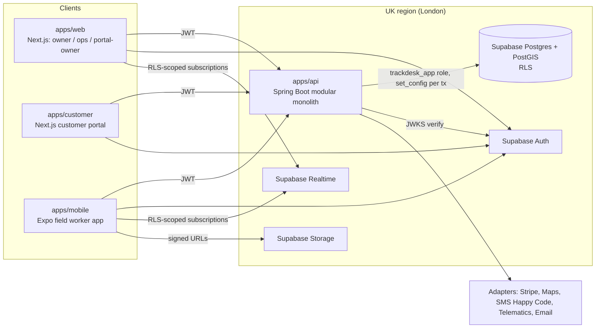

# Architecture

> Backend = Java 21 + Spring Boot modular monolith (DECISIONS D-001). **Any new dependency must be
> added to the "Dependency register" at the bottom of this file, with a reason.**

## 1. System context


## 2. Monorepo layout
```
apps/
  api/          Spring Boot (Gradle, Java 21) — exposed to Turbo via package.json scripts
  web/          Next.js App Router: (owner) (ops) (portal-owner) route groups
  customer/     Next.js customer portal
  mobile/       Expo / React Native field worker app
packages/
  contracts/    openapi/*.yaml (source of truth), permissions.yaml, src/ (generated TS + Zod + client), mocks/
  ui/           tokens.ts, tailwind preset, React components + Storybook
  ui-native/    React Native components sharing tokens
  config/       eslint, tsconfig, prettier presets
infra/terraform/  DRAFT IaC — human applies
supabase/         local stack config (Postgres/Auth/Realtime/Storage)
```

## 3. Backend: Spring Modulith module map
Root package `com.trackdesk`. Each module has `api/` (controllers implementing generated
interfaces), `application/` (services; the module's public surface), `domain/` (entities, rules,
events), `infrastructure/` (repositories, adapters). Modules talk **only** through `application`
service interfaces or Spring application events. This is enforced by `ModularityTests` (Spring
Modulith) and `ArchitectureTests` (ArchUnit).

| Module | Sprint | Responsibility |
|---|---|---|
| `platform` (shared) | 0 | tenancy, security, permissions, audit, feature flags, errors, logging, persistence base |
| `contracts` (shared, generated) | 0 | OpenAPI-generated interfaces (`contracts.api`) and DTOs (`contracts.model`) |
| `tenants` | 0 | company sign-up, tenant profile |
| `users` | 0/1 | users, invitations, roles |
| `teams` | 1 | teams, membership, skills |
| `customers` | 1 | **reference module** |
| `sites` | 1 | customer sites, PostGIS location |
| `assets` | 1 | BS 5839 / BS 5266 assets at sites |
| `jobs` | 2 | job aggregate, state machine, status history |
| `workorders` | 2 | work orders linking customer/site/assets |
| `maintenance` | 2 | PM schedules, recurrence → jobs (ShedLock), SLA timers |
| `dispatch` | 3 | availability, skills, assignment rules, PostGIS distance |
| `fieldwork` | 4 | execution, checklists, photos, signatures, consent, location, geofence, offline sync |
| `verification` | 5 | Happy Code OTP |
| `compliance` | 5 | certificates and records (immutable, versioned) |
| `portal` | 5 | customer portal queries, job requests |
| `quotes`, `invoices`, `payments` | 6 | money flows (BigDecimal, UK VAT), payment adapters, webhooks |
| `reporting` | 6 | read-only tenant-scoped reports |
| `chat` | 6 | conversations and messages (history/moderation; live via Realtime) |

## 4. Tenancy model
- Shared database and schema. Every tenant-scoped table has `tenant_id uuid not null`, an index
  that leads with `tenant_id`, `ENABLE` + `FORCE ROW LEVEL SECURITY`, and policies using
  `app_current_tenant()`.
- **Request path:**
  1. `BearerTokenAuthenticationFilter` verifies the Supabase JWT. JWKS is used in staging/prod;
     an HS256 secret is allowed only in the local and test profiles.
  2. `TenantContextFilter` reads `sub`, `app_metadata.tenant_id` and `app_metadata.role` into
     `TenantContext` (ThreadLocal) and MDC.
  3. `TenantAwareDataSource` runs `set_config('app.tenant_id' | 'app.user_id' | 'app.role', ?, false)`
     on connection checkout and `RESET`s on release. `TenantTransactionListener` also runs
     `set_config(..., true)` at the start of each transaction, so the settings are transaction-local
     as the playbook requires.
  4. Postgres RLS filters every statement. **Fail closed:** no setting means no rows.
  5. Hibernate `@Filter("tenantFilter")` on tenant entities is a second layer, never a replacement.
- The DB login used by the API (`trackdesk_app`) is not a superuser, not the table owner and has no
  `BYPASSRLS`. Flyway uses `trackdesk_owner`.
- Customer-role users (portal) get extra RLS predicates restricting rows to their `customer_id`.
- Permissions: `permissions.yaml` → generated `Permission` (Java) and `permissions.ts` →
  `@PreAuthorize("hasPermission(null, 'customers:create')")`. The same matrix is seeded into the
  `role_permission` table and used in RLS via `app_has_permission('…')` for writes.

## 5. Contract flow (OpenAPI-first)
```
packages/contracts/openapi/*.yaml ──bundle──▶ openapi.bundled.yaml
   ├─ openapi-generator (spring, interfaceOnly) ──▶ apps/api/build/generated/openapi (compileJava depends on it)
   ├─ orval ──▶ packages/contracts/src/generated/{types,zod,client}.ts
   └─ mocks/  (faker-based factories typed from generated types)
CI: pnpm contracts:generate && git diff --exit-code packages/contracts/src  (drift check)
```

## 6. Realtime
Supabase Realtime **Postgres Changes** on `job` and `technician_location_latest`, plus **Broadcast**
for chat typing. Postgres Changes respects RLS on the subscribing user's JWT, so the JWT
`app_metadata.tenant_id` must equal the row's tenant. RLS helpers therefore fall back to
`auth.jwt()` claims when `app.tenant_id` isn't set (Supabase context). The Sprint 3 test proves
that tenant A never receives tenant B events.

## 7. Offline sync (mobile)
expo-sqlite holds assigned jobs, checklists and a mutation queue. Each mutation has a
client-generated UUID and an `Idempotency-Key`. The API stores processed keys in
`idempotency_record` and replays the stored response. Conflict strategy: server-authoritative job
status with last-writer-wins on checklist answers per item (timestamped). Photos upload when online
via signed URLs. Details in Sprint 4.

## 8. Integrations (ports and adapters)
| Port | Real adapter | Local/test adapter |
|---|---|---|
| `PaymentGateway` | `StripePaymentGateway` (test mode) | `FakePaymentGateway`; `MerchantOfRecordPaymentGateway` stub |
| `MapsClient` | Google Maps / Mapbox geocoding | `FakeMapsClient` |
| `SmsSender` (Happy Code) | SMS provider | `FakeSmsSender` (logs + in-memory) |
| `TelematicsClient` | stub | stub |
| `AuthAdminClient` | Supabase Admin API (sets `app_metadata`, invites) | `FakeAuthAdminClient` |
| `EmailSender` | provider TBD | `FakeEmailSender` |

## 9. Environments
| Env | Purpose | Data | Region |
|---|---|---|---|
| local | developer machine (`pnpm db:start`, Supabase CLI) | synthetic seed | — |
| dev | shared integration, auto-deploy from `main` | synthetic | London |
| staging | release candidates, nightly E2E | synthetic / anonymised only | London |
| prod | customers | real | London — **human deploys only** |

## 10. Cross-cutting
Logging: SLF4J + Logback JSON (logstash encoder), with MDC `tenant_id`, `user_id`, `request_id`.
Errors: RFC 9457 Problem Details through `GlobalExceptionHandler`. Sentry (DSN from env).
Actuator: `health`, `info`, `prometheus`. Scheduled jobs use ShedLock (`shedlock` table, global).

## 11. Dependency register
| Dependency | Where | Why |
|---|---|---|
| Spring Boot 3.5 (web, security, oauth2-resource-server, data-jpa, validation, actuator, aop) | api | framework |
| Spring Modulith 1.4 | api | module boundaries and events |
| Flyway (+ flyway-database-postgresql) | api | the only migration tool |
| hibernate-spatial | api | PostGIS types |
| MapStruct 1.6 | api | entity ↔ DTO mapping |
| openapi-generator 7.14 (Gradle plugin) | api | Java interfaces/DTOs from the spec |
| jackson-databind-nullable, swagger-annotations | api | needed by the generated code |
| ShedLock 6 | api | single-runner scheduled jobs |
| logstash-logback-encoder | api | JSON logs |
| sentry-spring-boot-starter-jakarta | api | error tracking |
| micrometer-registry-prometheus | api | metrics |
| Testcontainers (postgresql), ArchUnit, RestAssured/MockMvc, AssertJ | api tests | testing |
| Spotless (google-java-format), JaCoCo | api build | quality |
| Turborepo, pnpm | root | monorepo |
| Next.js 15, React 19, Tailwind 3.4 | web, customer | UI |
| @supabase/supabase-js, @supabase/ssr | web, customer, mobile | auth + realtime |
| orval, zod, @redocly/cli | contracts | TS codegen and spec bundling |
| @faker-js/faker | contracts mocks | synthetic data only |
| Storybook 8, Vitest, Playwright | ui, web | tests and catalogue |
| Expo 53 (expo-location, expo-task-manager, expo-sqlite, expo-secure-store) | mobile | field app |
| class-variance-authority, clsx, tailwind-merge | ui | shadcn-style variants |
