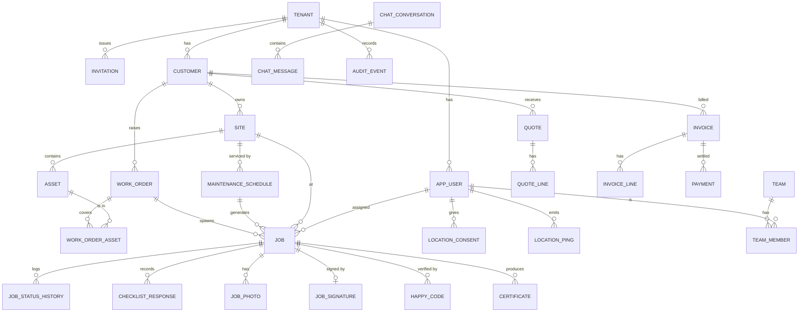

# Data Model

Source of truth: Flyway migrations in `apps/api/src/main/resources/db/migration`. This document
must be updated in the same PR as any migration.

## Conventions
- PK `id uuid default gen_random_uuid()`. Tenant tables have `tenant_id uuid not null references tenant(id)`.
- Every tenant table has `unique (tenant_id, id)`, so children use **composite FKs**
  `(tenant_id, parent_id) → parent(tenant_id, id)`. A row can never point at another tenant's row.
- Every tenant table has an index that leads with `tenant_id`, plus `ENABLE` + `FORCE ROW LEVEL SECURITY`.
  Default policies: `tenant_isolation_*` for select/insert/update/delete with
  `tenant_id = app_current_tenant()`.
- Timestamps are `timestamptz`, money is `numeric(12,2)` (`BigDecimal` in Java), geo is
  `geography(Point,4326)`.
- Mutable aggregates carry `version bigint` (optimistic locking), `created_at`, `updated_at` and `created_by`.
- Enums are `text` + `check` constraints, so changes are migrations rather than type alters.

## RLS helper functions (V1)
| Function | Returns |
|---|---|
| `app_current_tenant()` | `app.tenant_id` setting, else the Supabase JWT `app_metadata.tenant_id` (Realtime/PostgREST), else NULL (fail closed) |
| `app_current_user()` | `app.user_id`, else JWT `sub` |
| `app_current_role()` | `app.role`, else JWT `app_metadata.role` |
| `app_has_permission(text)` | whether `role_permission` grants the current role the permission |
| `app_current_customer()` | `customer_id` of the current user if role = customer |
| (capability) `app.invite_token_hash` setting | Lets a tenant-less invitee read/accept ONLY the invitation whose token hash they present (policies on `invitation`, `app_user`; DECISIONS D-015). SECURITY-REVIEW-REQUIRED |

## Tables
Legend for RLS intent: **T** = tenant isolation (all ops); **T+C** = tenant isolation plus a
customer-role restriction to own `customer_id`; **T+U** = tenant plus a field-worker restriction
to own rows; **G** = global, read-only to the app; **AO** = append-only.

### Platform (V1)
| Table | Key columns | RLS | Indexes |
|---|---|---|---|
| tenant | id, name, slug (unique), country_code='GB', status | `id = app_current_tenant()`; portal_owner may select all | slug |
| app_user | id (= Supabase auth uid), tenant_id, email, full_name, phone, role, status, customer_id? | T; field_worker/customer select self + colleagues' names | (tenant_id, email) unique |
| invitation | id, tenant_id, email, role, customer_id?, token_hash (unique), invited_by, expires_at, accepted_at | T, write needs `users:invite` | (tenant_id, email) |
| role_permission | role, permission (PK both) | G | — |
| audit_event | id, tenant_id, occurred_at, actor_user_id, actor_role, action, entity_type, entity_id, request_id, details jsonb | T, **AO** (no update/delete grant + trigger) | (tenant_id, occurred_at desc), (tenant_id, entity_type, entity_id) |
| feature_flag | key (PK), description, default_enabled | G | — |
| tenant_feature_flag | id, tenant_id, flag_key → feature_flag, enabled | T | (tenant_id, flag_key) unique |
| idempotency_record | id, tenant_id, user_id, idempotency_key, request_hash, response_status, response_body | T | (tenant_id, idempotency_key) unique |
| shedlock | name, lock_until, locked_at, locked_by | G (app read/write) | — |

### Sprint 1
| Table | Key columns | RLS |
|---|---|---|
| customer | id, tenant_id, name, account_number?, email?, phone?, billing address, notes, status(active/archived), version | T+C |
| site | id, tenant_id, customer_id, name, address lines, postcode, location geography(Point)?, access_notes, status | T+C |
| asset | id, tenant_id, site_id, asset_type (fire_alarm_panel, smoke_detector, heat_detector, call_point, sounder, emergency_light, exit_sign, central_battery, other), standard (BS5839/BS5266/OTHER), manufacturer, model, serial_number, location_description, location?, installed_on, status | T+C (via site) |
| team | id, tenant_id, name | T |
| team_member | id, tenant_id, team_id, user_id | T |
| technician_skill | id, tenant_id, user_id, skill | T |
| working_hours | id, tenant_id, user_id, day_of_week (1–7), starts_at, ends_at | T |

### Sprint 2
| Table | Key columns | RLS |
|---|---|---|
| work_order | id, tenant_id, customer_id, site_id, reference, title, description, priority, status | T+C |
| work_order_asset | id, tenant_id, work_order_id, asset_id | T |
| maintenance_schedule | id, tenant_id, site_id, standard, title, interval_months, next_due_on, lead_days, sla_hours, active | T+C (via site) |
| job | id, tenant_id, customer_id, site_id, work_order_id?, maintenance_schedule_id?, reference, job_type, status, priority, scheduled_start/end, assigned_user_id?, sla_due_at, completed_at, verified_at, client_id (offline idempotency), version | T+C; T+U for field_worker (assigned only) |
| job_status_history | id, tenant_id, job_id, from_status, to_status, changed_by, changed_at, reason | T |

Job status: `draft → scheduled → dispatched → en_route → on_site → completed → verified → invoiced`;
`cancelled` and `overdue` are side states (see the jobs PRD).

### Sprint 4: field work
| Table | Key columns | RLS |
|---|---|---|
| location_consent | id, tenant_id, user_id, consent_version, granted_at, revoked_at | T+U |
| location_ping | id, tenant_id, user_id, job_id?, location, accuracy_m, recorded_at, received_at | T+U, retention 90 days (DRAFT) |
| checklist_template | id, tenant_id, standard, name, version, items jsonb | T |
| checklist_response | id, tenant_id, job_id, template_id, item_key, answer, notes, answered_by, answered_at | T+U |
| job_photo | id, tenant_id, job_id, storage_path, content_type, taken_at, uploaded_at | T+U |
| job_signature | id, tenant_id, job_id, signer_name, storage_path, signed_at | T+U |

### Sprint 5
| Table | Key columns | RLS |
|---|---|---|
| happy_code | id, tenant_id, job_id, code_hash, sent_to_phone_last4, expires_at, attempts, max_attempts, verified_at | T (never returned to the customer role) |
| certificate | id, tenant_id, job_id, site_id, standard, certificate_type, version, supersedes_id?, status(draft/issued/superseded), storage_path, content_sha256, issued_at, issued_by | T+C; **immutable once issued** (trigger) |
| job_request | id, tenant_id, customer_id, site_id, requested_by, description, preferred_date, status | T+C |

### Sprint 6
| Table | Key columns | RLS |
|---|---|---|
| quote | id, tenant_id, customer_id, site_id, reference, status, valid_until, subtotal, vat_total, total, accepted_at, job_id? | T+C |
| quote_line | id, tenant_id, quote_id, description, quantity, unit_price, vat_rate, line_total | T+C (via quote) |
| invoice | id, tenant_id, customer_id, job_id?, reference, status, issued_on, due_on, subtotal, vat_total, total, amount_paid | T+C |
| invoice_line | id, tenant_id, invoice_id, description, quantity, unit_price, vat_rate, line_total | T+C (via invoice) |
| payment | id, tenant_id, invoice_id, provider, provider_ref, amount, status, received_at | T+C |
| processed_webhook_event | provider, event_id (PK), event_type, processed_at | G (platform-level; no tenant data stored) |
| chat_conversation | id, tenant_id, kind (ops_worker / ops_customer), job_id?, customer_id? | T + participant |
| chat_participant | id, tenant_id, conversation_id, user_id | T |
| chat_message | id, tenant_id, conversation_id, sender_user_id, body, sent_at, hidden_at | T + participant |

Reporting uses tenant-scoped repository queries over the tables above. No extra tables in v1.

## ER diagram (core)

